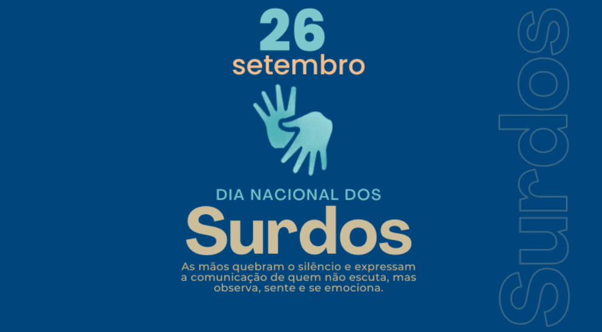
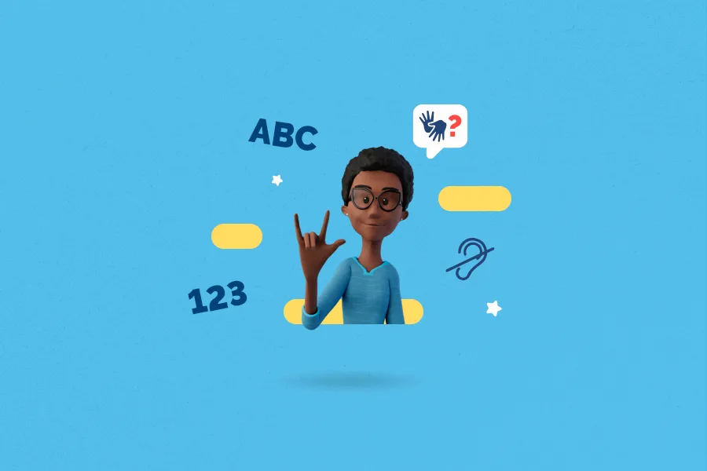
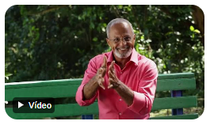

<div align="center">

  

  # 🤟 INCLUSÃO, ACESSIBILIDADE E LIBRAS

  **26 de setembro — Dia Nacional dos Surdos**

  Respeitar as diferenças é construir uma sociedade mais inclusiva.

  
  
  
  

</div>

---

## 💙 Sobre o projeto

Este projeto foi desenvolvido durante as aulas de Programação Web do curso Técnico em Desenvolvimento de Sistemas da ETEC.

A atividade surgiu a partir de um desafio proposto pela professora durante uma aula de CSS, com o objetivo de aplicar os conhecimentos adquiridos em sala de aula na construção de uma página educativa sobre inclusão e acessibilidade.

O projeto aborda o Dia Nacional dos Surdos, valorizando a comunidade surda, sua cultura, seus direitos e a importância da Língua Brasileira de Sinais (Libras).

## 📅 Dia Nacional dos Surdos

Celebrado em 26 de setembro, o Dia Nacional dos Surdos foi instituído pela Lei nº 11.796/2008.

A data representa uma oportunidade de conscientização sobre os direitos, as conquistas e a participação das pessoas surdas na sociedade.

## 🤟 Língua Brasileira de Sinais — Libras

<div align="center">
  
</div>

A Libras é uma língua de modalidade visual-espacial, reconhecida legalmente pela Lei nº 10.436/2002.

Valorizar a Libras significa reconhecer a diversidade linguística, respeitar a cultura surda e contribuir para uma sociedade com menos barreiras de comunicação.

## ✨ Conteúdos apresentados

- Dia Nacional dos Surdos.
- Importância da Libras.
- Inclusão social.
- Acessibilidade e comunicação.
- Direitos da comunidade surda.
- Referências à legislação brasileira.
- Imagens e materiais educativos.
- Links para conteúdos complementares.

## 🎥 Material educativo

<div align="center">

  <a href="https://youtu.be/97f2KhahLGM">
    
  </a>

  Clique na imagem para assistir ao vídeo.

</div>

## 💻 Tecnologias utilizadas

| Tecnologia | Aplicação |
|---|---|
| HTML5 | Estruturação do conteúdo |
| CSS3 | Estilização e identidade visual |
| Hyperlinks | Navegação para conteúdos externos |
| Multimídia | Integração de imagens e links para vídeos |

## 📂 Estrutura do projeto

```text
atividade-inclusao-etec/
├── index.html
├── inclusaoatividade.html
├── inclusao.webp
├── surdin.jpg
├── video.png
└── README.md
```

## 🚀 Como executar o projeto

Clone o repositório:

```bash
git clone https://github.com/truemelloo/atividade-inclusao-etec.git
```

Abra o arquivo `index.html` diretamente no navegador.

Não é necessário instalar dependências.

## 🎓 Objetivo acadêmico

O projeto foi desenvolvido com a finalidade de colocar em prática os conhecimentos adquiridos nas aulas de Programação Web:

- Estruturação de documentos HTML.
- Estilização utilizando CSS.
- Formatação de textos e títulos.
- Organização de elementos visuais.
- Inserção de imagens.
- Utilização de links externos.
- Desenvolvimento de páginas educativas.

Além do aprendizado técnico, a atividade incentiva a reflexão sobre o papel da tecnologia na conscientização e na inclusão social.

## 📖 Referências

- [Lei nº 11.796/2008 — Dia Nacional dos Surdos](https://www.planalto.gov.br/ccivil_03/_ato2007-2010/2008/lei/l11796.htm)
- [Lei nº 10.436/2002 — Libras](https://www.planalto.gov.br/ccivil_03/leis/2002/l10436.htm)
- [Instituto Nacional de Educação de Surdos — INES](https://www.gov.br/ines/pt-br)

## 👩🏻‍💻 Desenvolvedora

**Ana Clara Mello**

Designer Gráfica & Desenvolvedora em formação.

Estudante do curso Técnico em Desenvolvimento de Sistemas — ETEC.

[](https://github.com/truemelloo)
[](https://www.linkedin.com/in/anaclarasouzamello/)
[](https://www.instagram.com/truemelloo/)

---

<div align="center">

  **A tecnologia também é uma ferramenta de inclusão.**

  Desenvolvido com criatividade, conhecimento e propósito. 💙

  ⭐ Se gostou do projeto, deixe uma estrela!

</div>
